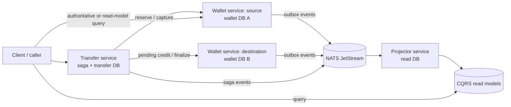

# Digital Wallet Backend

Fintech-grade digital wallet backend built around an immutable, double-entry journal. The system uses two logical wallet instances (`wallet-source` and `wallet-destination`), a transfer-service saga, a transactional outbox, NATS JetStream delivery, and rebuildable CQRS read models.

Correctness is the primary goal. Balances are reproducible from the journal; duplicate commands and events cannot create money; ambiguous side effects are handed to reconciliation rather than guessed at.

**Status:** v1 implementation complete. The repository includes the wallet
ledger, event delivery, CQRS projections, transfer saga, reconciliation tooling,
operator CLIs, and contention-first benchmark evidence.

## Scope

The v1 scope is deliberately narrow:

- one currency: USD;
- wallet-to-wallet transfers only;
- integer minor units, never floating point;
- Go services using `net/http` or `chi`, `slog`, PostgreSQL, NATS JetStream, `sqlc`, and `goose` or `golang-migrate`;
- no fees, FX, external rails, auth/KYC, multi-region deployment, Kubernetes, Kafka, Redis, Temporal, or central ledger.

## Architecture at a glance



Each wallet instance owns its own accounts and journal. The transfer service coordinates the cross-database workflow but has no access to wallet schemas. The projector consumes events and owns only read models.

## Documentation index

| Document | Purpose |
| --- | --- |
| [Product requirements](docs/product-requirements.md) | Product scope, user journeys, requirements, invariants, and explicit non-goals |
| [Project status](docs/project-status.md) | Completed phase/tag matrix, verification gate, evidence, and known boundaries |
| [Architecture](docs/architecture.md) | System context, containers, responsibilities, and ownership |
| [Ledger invariants](docs/ledger-invariants.md) | Double-entry rules, balance formulas, and safety invariants |
| [Event model](docs/event-model.md) | Event envelope, catalog, ordering, and deduplication |
| [Saga](docs/saga.md) | Transfer state machine, retries, compensation, and reconciliation |
| [Outbox and inbox](docs/outbox-inbox.md) | Durable publication and consumer crash safety |
| [CQRS projections](docs/cqrs-projections.md) | Read models, cursors, rebuild, validation, and promotion |
| [Reconciliation](docs/reconciliation.md) | Checks, exception lifecycle, and operator runbook |
| [Data model](docs/data-model.md) | ER diagrams for wallet, transfer, and read databases |
| [API](docs/api.md) / [OpenAPI](api/openapi.yaml) | Public and internal HTTP contracts |
| [Testing strategy](docs/testing-strategy.md) | Unit, integration, failure-injection, and state-machine testing |
| [Benchmarking](docs/benchmarking.md) | Contention-first benchmark plan and result template |
| [Operations](docs/operations.md) | Local run, environment, migrations, CLIs, and troubleshooting |
| [ADRs](docs/adr/README.md) | Indexed architecture decision records |

## What is included

| Capability | Description |
| --- | --- |
| Wallet ledger | Tenant-scoped USD wallets, immutable double-entry postings, authoritative balances, deposits, withdrawals, holds, and idempotency. |
| Event delivery | Transactional outbox, leased relay, NATS JetStream, inbox deduplication, ordered consumption, buffering, and dead-letter handling. |
| Read models | Payload-only CQRS projections with watermarks, read-your-writes waits, dual-slot rebuilds, verification, promotion, rollback, and retirement. |
| Transfers | Cross-wallet saga with reserve, pending credit, capture, finalize, bounded retries, compensation, and explicit ambiguous-outcome handling. |
| Reconciliation | Immutable exception lifecycle, append-only investigation notes, evidence-based resolution, and no automatic balance repair. |
| Operations | `walletctl`, `transferctl`, `outboxctl`, `projectorctl`, internal stats endpoints, role isolation, and repeatable CI checks. |
| Benchmarks | Six contention-first workloads with recorded p50, p95, p99, throughput, and correctness results. |

## Correctness rules

- The journal is the financial authority; read models are disposable and
  eventually consistent.
- Every journal transaction balances debits and credits.
- Available balance cannot become negative, including under concurrent
  withdrawals.
- Duplicate commands and events do not create duplicate financial effects.
- The transfer service never reads wallet databases directly.
- Ambiguous side effects enter reconciliation; they are not blindly compensated.
- Reconciliation detects and records mismatches but never adjusts balances.
- Internal routes are token-protected and isolated from public listeners.

## Quickstart

The completed v1 stack runs locally through Docker Compose. From the repository
root:

```text
make up
make migrate
curl http://localhost:8081/readyz
curl http://localhost:8082/readyz
curl http://localhost:8083/readyz
curl http://localhost:8084/readyz
```

The service health endpoints are:

| Service | URL |
| --- | --- |
| wallet-source | <http://localhost:8081/readyz> |
| wallet-destination | <http://localhost:8082/readyz> |
| transfer | <http://localhost:8083/readyz> |
| projector | <http://localhost:8084/readyz> |

Stop the local stack with `make down`. The Compose credentials are local-development values only; do not reuse them outside the local stack.

## Verification and benchmarks

Run the full repository gate:

```text
make ci
```

Run the Phase 8 benchmark harness against the running stack:

```text
make benchmark ARGS="-ops=50 -concurrency=16 -repeats=3"
```

The benchmark command updates [`docs/benchmarking.md`](docs/benchmarking.md)
and writes machine-readable results to
[`.ecc/benchmarks/phase8.json`](.ecc/benchmarks/phase8.json). The benchmark
module is outside the four-module workspace, so its standalone checks are:

```text
cd benchmarks
GOWORK=off go test ./...
GOWORK=off go vet ./...
```

For a route-level view, start with [`docs/api.md`](docs/api.md). For operating
the local stack or recovering from an ambiguous transfer, use
[`docs/operations.md`](docs/operations.md) and
[`docs/reconciliation.md`](docs/reconciliation.md).
