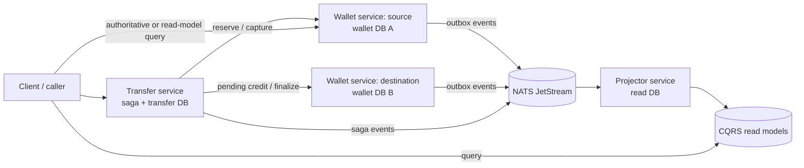

# Digital Wallet Backend

Fintech-grade digital wallet backend built around an immutable, double-entry journal. The system uses two logical wallet instances (`wallet-source` and `wallet-destination`), a transfer-service saga, a transactional outbox, NATS JetStream delivery, and rebuildable CQRS read models.

Correctness is the primary goal. Balances are reproducible from the journal; duplicate commands and events cannot create money; ambiguous side effects are handed to reconciliation rather than guessed at.

## Scope

The v1 scope is deliberately narrow:

- one currency: USD;
- wallet-to-wallet transfers only;
- integer minor units, never floating point;
- Go services using `net/http` or `chi`, `slog`, PostgreSQL, NATS JetStream, `sqlc`, and `goose` or `golang-migrate`;
- no fees, FX, external rails, auth/KYC, multi-region deployment, Kubernetes, Kafka, Redis, Temporal, or central ledger.

## Architecture at a glance



Each wallet instance owns its own accounts and journal. The transfer service coordinates the cross-database workflow but has no access to wallet schemas. The projector consumes events and owns only read models.

## Documentation index

| Document | Purpose |
| --- | --- |
| [Architecture](docs/architecture.md) | System context, containers, responsibilities, and ownership |
| [Ledger invariants](docs/ledger-invariants.md) | Double-entry rules, balance formulas, and safety invariants |
| [Event model](docs/event-model.md) | Event envelope, catalog, ordering, and deduplication |
| [Saga](docs/saga.md) | Transfer state machine, retries, compensation, and reconciliation |
| [Outbox and inbox](docs/outbox-inbox.md) | Durable publication and consumer crash safety |
| [CQRS projections](docs/cqrs-projections.md) | Read models, cursors, rebuild, validation, and promotion |
| [Reconciliation](docs/reconciliation.md) | Checks, exception lifecycle, and operator runbook |
| [Data model](docs/data-model.md) | ER diagrams for wallet, transfer, and read databases |
| [API](docs/api.md) / [OpenAPI](api/openapi.yaml) | Public and internal HTTP contracts |
| [Testing strategy](docs/testing-strategy.md) | Unit, integration, failure-injection, and state-machine testing |
| [Benchmarking](docs/benchmarking.md) | Contention-first benchmark plan and result template |
| [Operations](docs/operations.md) | Local run, environment, migrations, CLIs, and troubleshooting |
| [ADRs](docs/adr/) | Eight architecture decision records |

## Phase plan

1. Contracts and documentation — current phase.
2. Repository foundation and local infrastructure.
3. Immutable wallet ledger.
4. Outbox and event consumption.
5. CQRS projections.
6. Transfer saga.
7. Reconciliation and operations tooling.
8. Contention-first benchmarks.

## Quickstart status

Phase 1 defines the contracts only. The executable `docker compose up` quickstart and Go commands will be added in Phase 2 without changing the locked contracts. Once the foundation exists, the expected flow will be:

```text
cp .env.example .env
docker compose up --build
make migrate
```

## Phase 1 acceptance

- All required contract documents and ADRs exist.
- Required Mermaid diagrams are included in the relevant documents.
- Public and internal endpoint shapes, idempotency semantics, event ordering, saga failure handling, and projection rebuild protocol are written down before implementation.
- No application dependencies, generated code, credentials, or unverified runtime claims are included in this phase.
