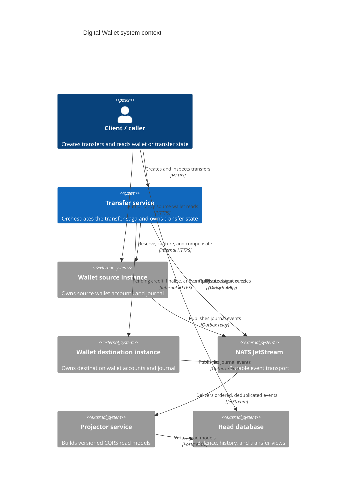
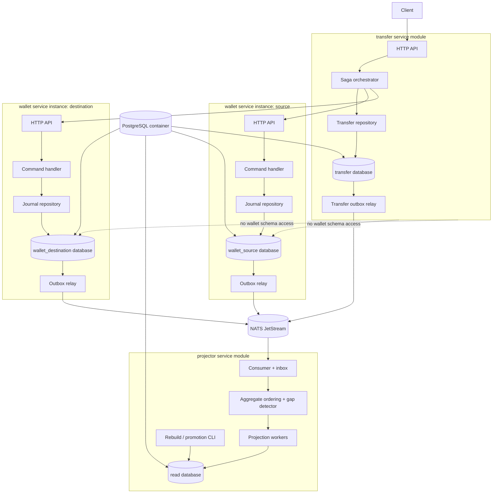

# Architecture

## System context

The wallet backend supports a caller that creates a wallet-to-wallet transfer. A transfer service owns the workflow state and calls two isolated instances of the same wallet service. Each wallet service owns its accounts and journal in a separate database. Events leave each service through a transactional outbox and are delivered through NATS JetStream to the projector and other consumers.

## Containers and component boundaries

The dashed relationship is a boundary rule, not a network connection. The transfer module may call wallet HTTP/internal APIs and consume contract events, but it must not import wallet storage packages or query wallet tables.

The Phase 2 Compose deployment uses one PostgreSQL container with four databases (`wallet_source`, `wallet_destination`, `transfer`, and `read`) and four database roles. This is a local-development topology only; service role grants remain database-scoped and the transfer role has no `CONNECT` privilege on either wallet database.

## Responsibilities and ownership

| Component | Owns | Does not own |
| --- | --- | --- |
| Wallet service instance | Wallet identity, accounts, immutable journal, idempotency records, outbox, local reservation state | Transfer saga state, read-model tables |
| Transfer service | Transfer aggregate, saga state, step attempts, idempotency, reconciliation hand-off, outbox | Wallet journal or wallet schema |
| Projector | Inbox, aggregate cursors/buffers, versioned balance/history/transfer views, projection versions | Any authoritative money state |
| NATS JetStream | Durable delivery and replay window | Business truth or deduplication correctness |
| PostgreSQL | Durable source of truth inside each service boundary | Cross-service atomicity |

## Service isolation

The Go workspace contains `services/wallet`, `services/transfer`, `services/projector`, and a narrow `shared` module. Wallet source and destination are the same wallet binary with different configuration, database URLs, tenant scope, and logical instance identity. Separate PostgreSQL roles enforce the database boundary. A CI check rejects transfer imports of wallet storage packages.

## Consistency vocabulary

- **Authoritative:** a journal-derived read from the owning wallet database. It can be recomputed at any time.
- **Read-model consistent through:** the highest event sequence or per-aggregate version known to have been applied to the selected projection version.
- **Eventually consistent:** a projector read that may lag the journal but reports its watermark.
- **Ambiguous:** a command's side effect cannot be classified as absent or confirmed; it must enter reconciliation rather than being retried blindly or compensated automatically.
