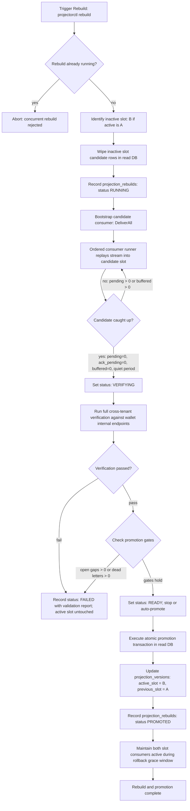
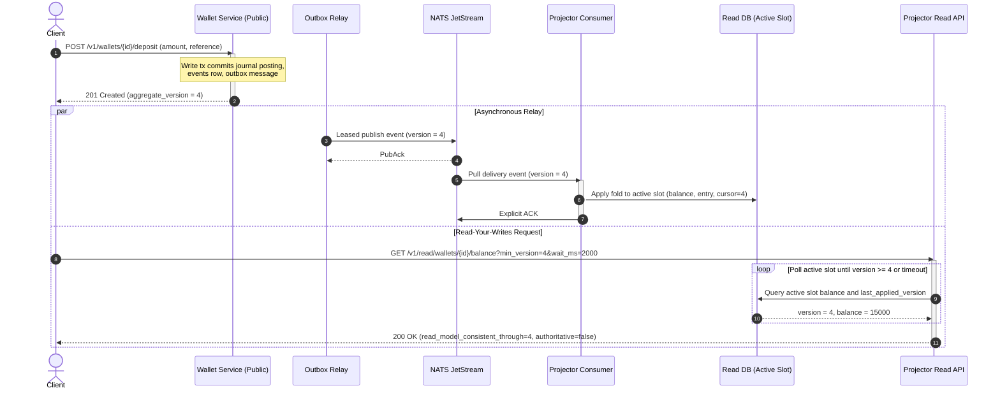

# CQRS projections

The wallet journal and transfer saga states are write-side authority. The projector consumes durable domain events from NATS JetStream and builds query-optimized read models in a dedicated read database. Projection views are disposable and reproducible from retained event streams.

## Scope

Phase 5 builds and verifies:
- `wallet_balance_view`: high-performance read-model balances with per-wallet consistency cursors;
- `wallet_entry_view`: keyset-paginated immutable transaction history constructed solely from event payloads.

> [!NOTE]
> `transfer_view` moves to Phase 6 because transfer events (`transfer.created`, `transfer.step_changed`, etc.) are introduced alongside the saga orchestrator in Phase 6.

## Read models and slot design

Rather than executing runtime DDL (`CREATE TABLE ..._vN`) during deployments or rebuilds, Phase 5 uses a dual-slot schema architecture (`slot a` and `slot b`):

| View | Primary key | Contents | Consistency contract |
| --- | --- | --- | --- |
| `wallet_balance_view` | `(projection_slot, tenant_id, wallet_id, currency)` | Posted and available USD minor units, last applied aggregate version, update timestamp. | Reports `read_model_consistent_through` (aggregate version). |
| `wallet_entry_view` | `(projection_slot, tenant_id, wallet_id, entry_version)` | Ordered transaction history, event ID, journal transaction ID, entry type, amount, currency, reference, occurred_at. | Replays from journal events; entry versions run contiguously from 1. |

Every view row contains `projection_slot` (`a` or `b`). The read database table `projection_versions` maintains the currently active slot (`active_slot`) and previous slot (`previous_slot`) for each projection name (e.g. `wallet_balances`).

### Active slot query resolution

Read queries resolve the active slot in the same SQL statement without application-level cache drift:

```sql
SELECT
    wbv.wallet_id,
    wbv.currency,
    wbv.posted_balance_minor,
    wbv.available_balance_minor,
    wbv.last_applied_version,
    wbv.projection_slot,
    wbv.updated_at
FROM wallet_balance_view AS wbv
JOIN projection_versions AS pv
  ON pv.projection_name = 'wallet_balances' AND pv.active_slot = wbv.projection_slot
WHERE wbv.tenant_id = $1 AND wbv.wallet_id = $2 AND wbv.currency = $3;
```

## JetStream stream retention contract

The `WALLET_EVENTS` file-backed JetStream stream must have unlimited retention (`MaxAge = 0` / no time limit) so a rebuild can replay from the beginning of time. This is verified and asserted during stream bootstrap. The wallet database `events` table remains the durable root of truth; in the event of stream loss, an operator tool can reset outbox publish watermarks to reconstruct the stream.

## Dual-slot rebuild and promotion lifecycle

A rebuild targets the inactive slot without affecting active read traffic. Each slot maintains an independent durable pull consumer in JetStream (`projector-balance-a` and `projector-balance-b`).



### Rebuild states

The `projection_rebuilds` table tracks the lifecycle of every rebuild attempt:
1. `RUNNING`: Candidate slot cleared; shadow consumer started with `DeliverAll`.
2. `CATCHING_UP`: Stream replayed; consuming live events until backlog is drained.
3. `VERIFYING`: Candidate consumer is quiet; full cross-tenant comparison is executing.
4. `READY`: Verification passed and gates hold; awaiting promotion command (or promoted immediately if `--auto-promote` was passed).
5. `PROMOTED`: Active slot pointer atomically swapped to candidate slot.
6. `FAILED`: Verification or promotion gates failed; validation report recorded; candidate slot left for diagnostic inspection.
7. `ABORTED`: Rebuild cancelled by operator.

### Promotion gates

Promotion to active requires all of the following conditions to hold simultaneously:
1. **Backlog drained**: Candidate consumer has `pending == 0`, `ack_pending == 0`, `buffered_events == 0`, and has maintained zero backlog for a quiet stability period.
2. **Zero defects**: Candidate consumer has `open_gaps == 0` and `dead_letters == 0`.
3. **Fresh verification**: Cross-tenant verification against authoritative wallet instances passed within the last 30 seconds.

### Post-promotion grace and rollback

Both slot consumers continue running after promotion for an operational grace window. If an issue is discovered after promotion, `projectorctl rollback` performs an instant atomic pointer swap back to `previous_slot`, serving current reads without data loss. `projectorctl retire` stops the decommissioned consumer and clears its slot.

## Authoritative verification contract

Verification is full and exhaustive across all tenants (no sampling):
1. **Cross-tenant internal endpoint**: Each wallet service exposes `GET /internal/v1/wallets/verify` on its isolated internal listener (`INTERNAL_HTTP_ADDR`), protected by `X-Internal-Token`. It returns keyset-paginated `(tenant_id, wallet_id, currency, posted_balance_minor, as_of_version)` computed in a single `REPEATABLE READ` transaction snapshot.
2. **Equal-version comparison**: For each wallet, the verifier compares the wallet instance's `(as_of_version, posted_balance_minor)` against the candidate slot's `(last_applied_version, posted_balance_minor)`:
   - If versions match, posted balances must be identical.
   - If candidate projection is behind, the verifier retries until caught up or timeout expires.
3. **Invariant checks**:
   - Projected `posted_balance_minor` strictly equals the `SUM(amount_minor)` of all entries in `wallet_entry_view`.
   - Entry versions in `wallet_entry_view` run contiguously from 1 to `last_applied_version` without gaps.
   - Candidate slot matches the active slot for all wallets where versions are equal.
   - No wallet present in the authoritative source is missing from the candidate projection.

## Read API and read-your-writes consistency

The projector public listener serves query endpoints:
- `GET /v1/read/wallets/{wallet_id}/balance?min_version=&wait_ms=`
- `GET /v1/read/wallets/{wallet_id}/entries?after_version=&limit=`

### Read-your-writes flow



### Consistency contract rules

1. **Wait for version**: When `min_version` is specified, the read API polls the active slot until `last_applied_version >= min_version` or `wait_ms` expires (maximum 5,000 ms).
2. **Lag timeout**: If `min_version` is not reached before `wait_ms` elapses, the endpoint returns `409 Conflict` with error code `read_model_behind` and a `Retry-After: 1` header.
3. **Tenant isolation**: An unknown wallet or a request presenting a tenant ID that does not own the wallet returns `404 Not Found`.
4. **Authoritative fallback**: The response explicitly marks `authoritative: false`. When immediate strict consistency is mandatory and cannot tolerate projection lag, clients query the wallet service's authoritative endpoint `GET /v1/wallets/{wallet_id}/balance`.
