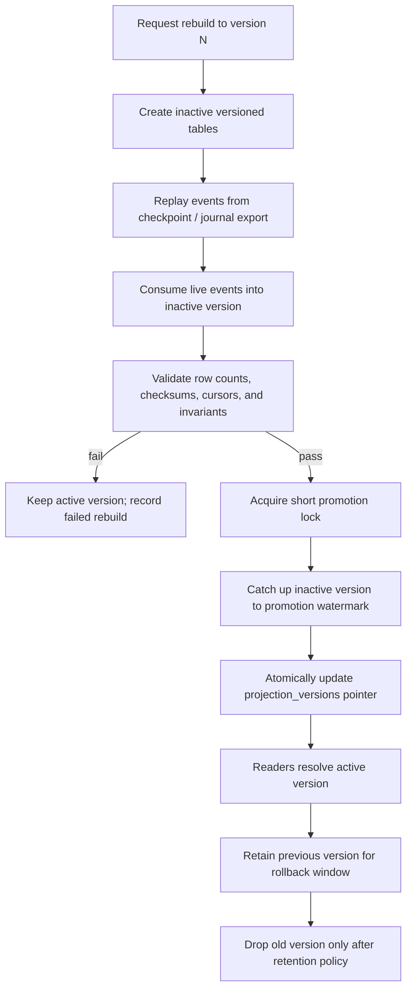

# CQRS projections

The journal and transfer state are write-side truth. The projector consumes events and builds query-optimized views in a separate read database. Projection views are disposable and reproducible.

## Read models

| View | Key | Contents | Freshness contract |
| --- | --- | --- | --- |
| `wallet_balance_view` | tenant + wallet + version | Current, held, and available USD minor units; source watermark. | Reports `read_model_consistent_through`. |
| `wallet_entry_view` | tenant + wallet + journal entry | Human-readable immutable entry history and postings. | Replays from journal events. |
| `transfer_view` | tenant + transfer | Saga state, step status, amount, and last known watermark. | Never authoritative for money. |

Every view row contains `projection_version` and the event watermark used to build it. The read API returns `read_model_consistent_through` with data so callers can decide whether eventual consistency is sufficient.

## Normal consumption

The projector consumer commits the inbox insert, aggregate ordering cursor, projection mutation, and read-model watermark in one transaction. It never mutates a journal. A projection can be deleted and rebuilt from retained domain events or an authoritative journal replay export.

## Versioned rebuild and promotion

There are two physical versions of each projection table, for example `wallet_balance_view_v17` and `wallet_balance_view_v18`, plus a `projection_versions` pointer per projection name. A rebuild always targets the inactive version.



The promotion transaction changes only the pointer and metadata; readers never observe a partially copied table. Validation includes:

- equal row counts against the source event range or expected aggregate set;
- deterministic checksum of sorted `(tenant_id, key, amount_minor, version)` tuples;
- no negative available balances;
- no missing or duplicate applied event IDs;
- cursor and `read_model_consistent_through` at least the declared promotion watermark.

Rollback is another atomic pointer update to the retained previous version. Rollback does not edit the journal or acknowledge a failed projection as correct.

## Consistency API behavior

`GET /v1/wallets/{wallet_id}/balance` on the owning wallet service is authoritative. Read-model APIs return:

```json
{
  "data": {},
  "read_model_consistent_through": {
    "event_time": "2026-10-19T12:00:00Z",
    "aggregate_versions": {"wallet/0192...": 7}
  }
}
```

An optional `X-Require-Consistent-Through` request header can ask the read API to wait up to a bounded timeout. If the watermark cannot be met, return `409 projection_not_caught_up` rather than silently serving older data.
