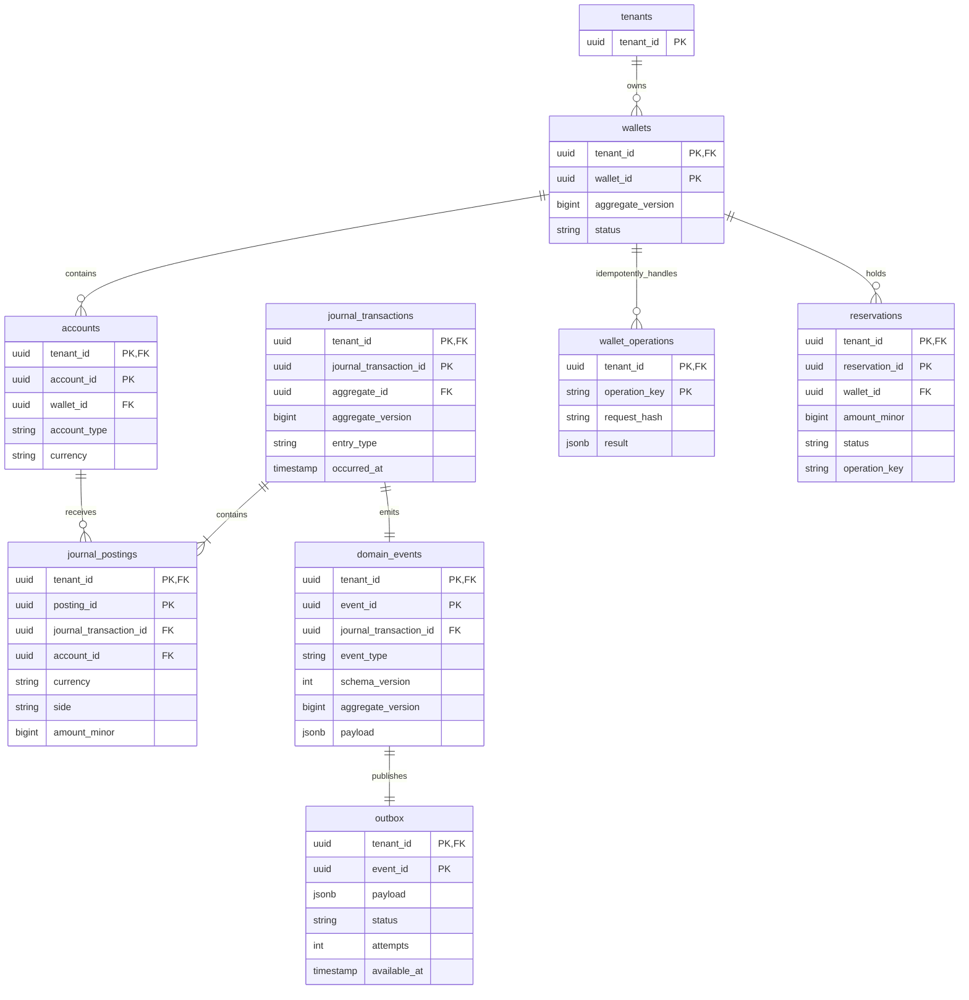
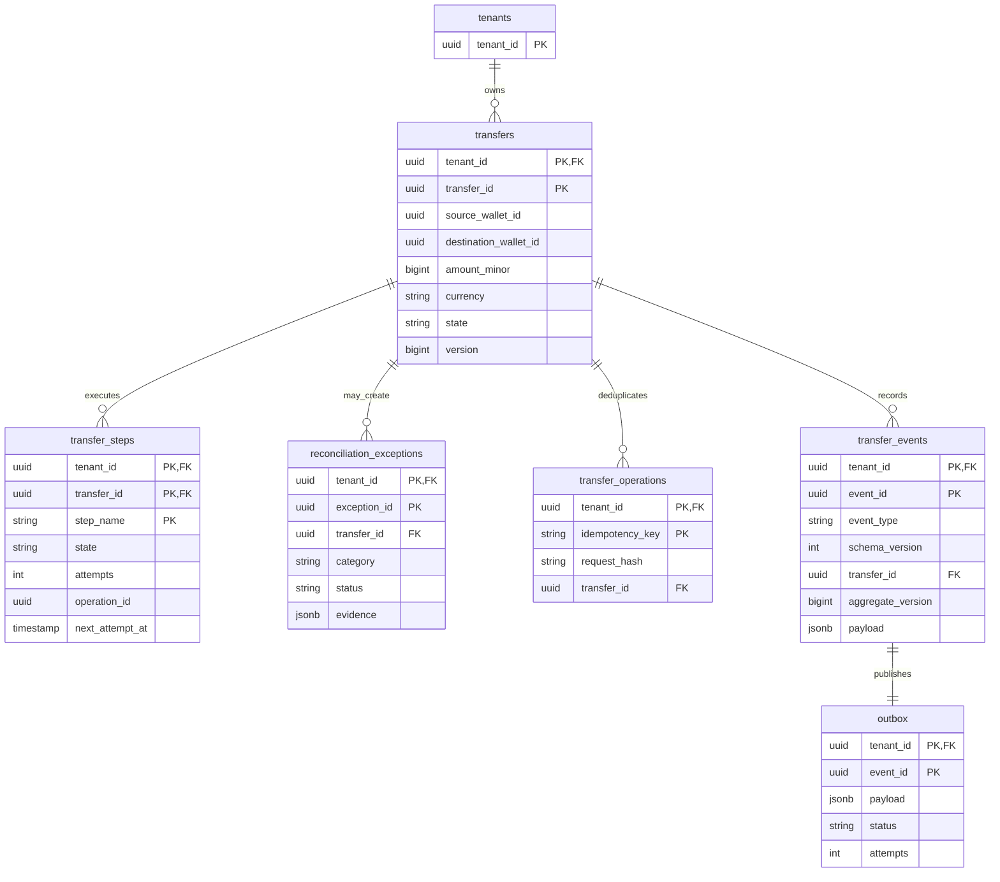
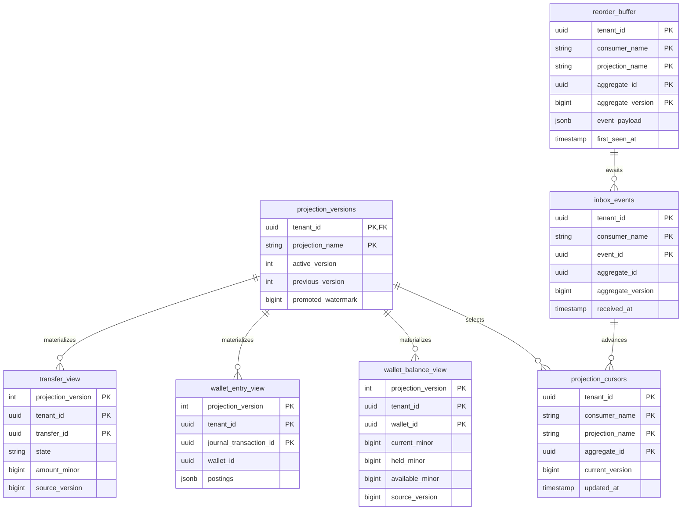

# Data model

All tables have `tenant_id NOT NULL`. Foreign keys that cross tables are composite `(tenant_id, referenced_id)` keys. The examples below show the contract shape; physical names may be refined during migration implementation without weakening the constraints.

## Wallet database (one database per logical wallet instance)

There is no mutable wallet balance table in the authoritative wallet schema. `reservations` is a journal-linked state index, not a balance source; replay can rebuild it and the journal remains the money source.

## Transfer database

The transfer database contains references to wallet IDs and operation IDs, not wallet foreign keys or wallet journal rows.

## Read database

