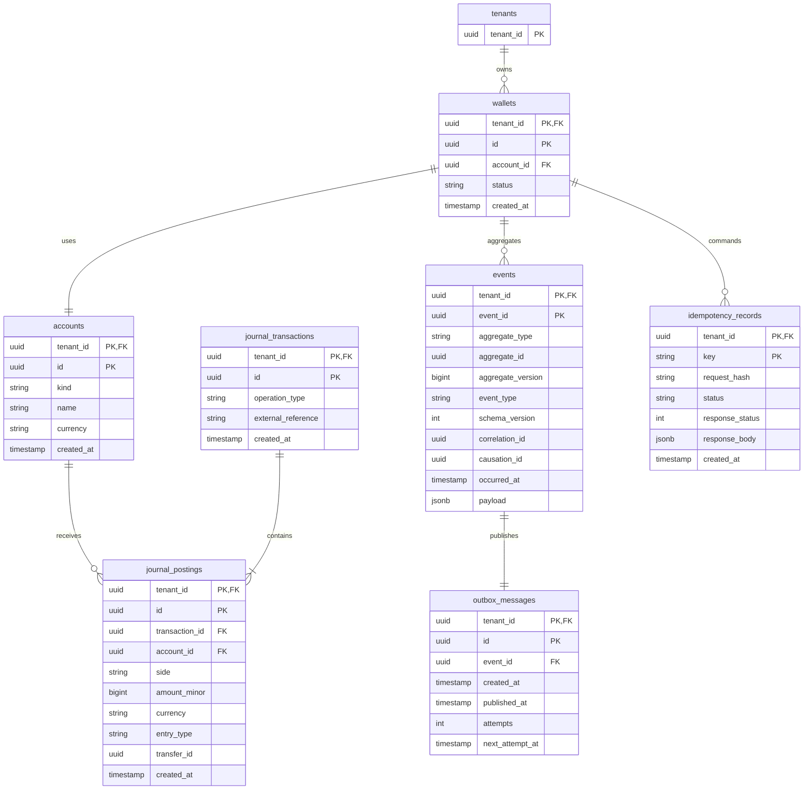
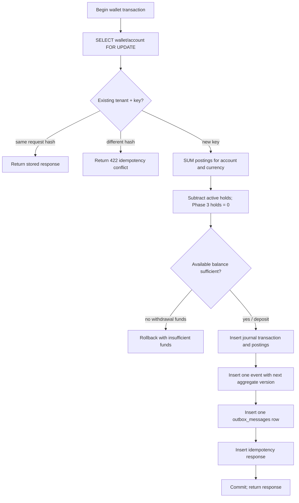
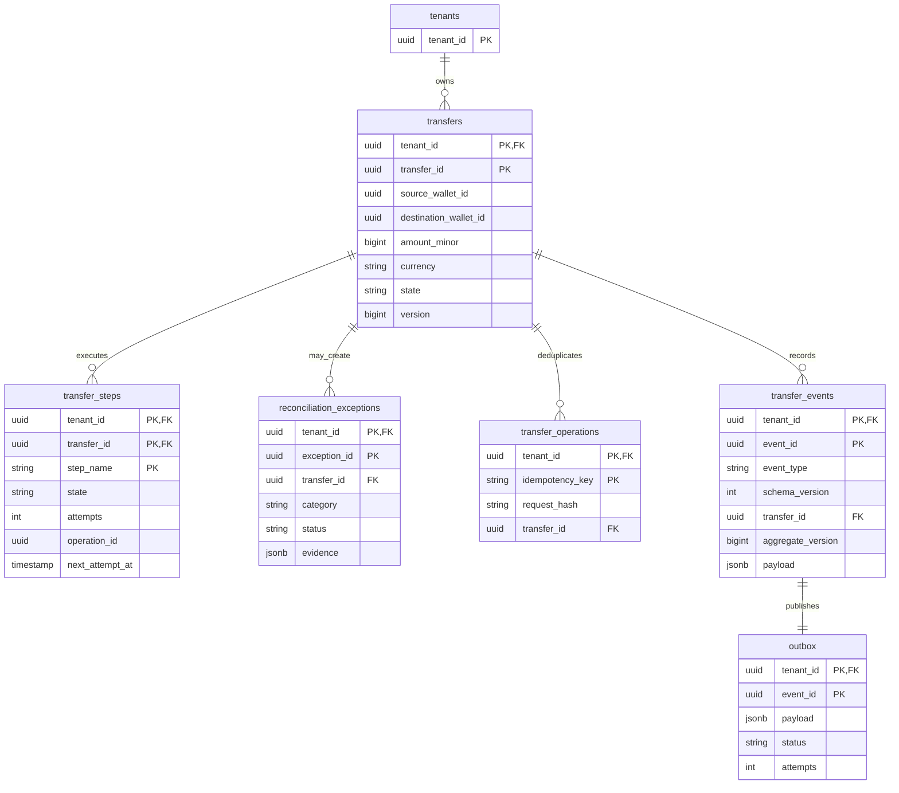
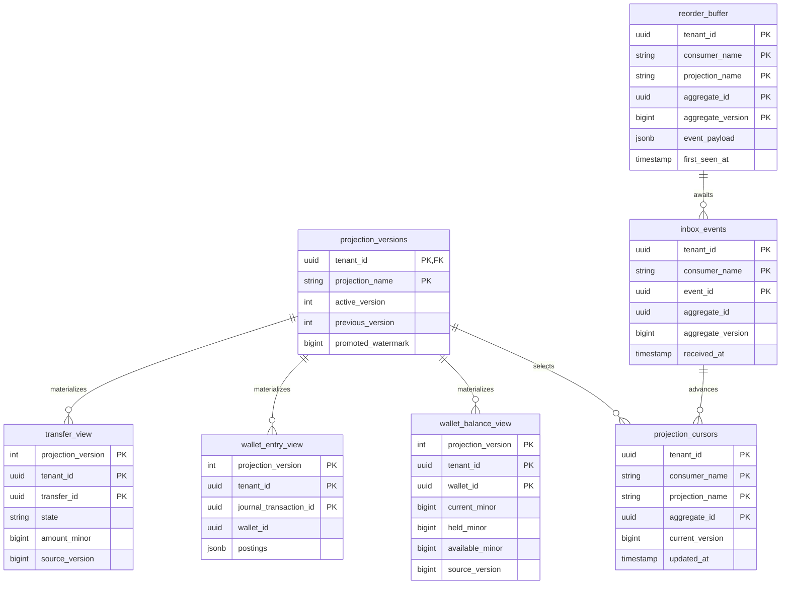

# Data model

All tables have `tenant_id NOT NULL`. Foreign keys that cross tables are composite `(tenant_id, referenced_id)` keys. The wallet schema below is implemented in Phase 3; transfer and read schemas remain the Phase 1/2 contracts.

## Wallet database (one database per logical wallet instance)

`accounts.kind` is either `user_wallet` or `system_clearing`. Each tenant has the four named clearing accounts (`deposit-clearing`, `withdrawal-clearing`, `outbound-clearing`, and `inbound-clearing`) created idempotently when first needed or during wallet creation. Only the user-wallet account is subject to the non-negative available-balance invariant.

`events` and `outbox_messages` store the event envelope and are inserted in the same transaction as the wallet change. Phase 3 does not publish or update outbox rows; the relay begins in Phase 4.

The database uses composite tenant foreign keys for mutable account references. References from `journal_postings` to immutable `journal_transactions`, and from `outbox_messages` to immutable `events`, use equivalent tenant-scoped insert validation triggers because PostgreSQL foreign-key key-share checks require UPDATE privilege on the referenced table. Wallet roles retain only INSERT and SELECT on immutable tables. Additional triggers reject UPDATE, DELETE, and TRUNCATE on `journal_transactions`, `journal_postings`, and `events`. A deferred constraint trigger checks debit/credit equality for each transaction and posting currency at commit.

There is no mutable wallet balance table anywhere in the wallet database. The authoritative balance is always recomputed from `journal_postings`; holds are a future extension point and are currently zero.

## Transfer database

The transfer database contains references to wallet IDs and operation IDs, not wallet foreign keys or wallet journal rows.

## Read database

