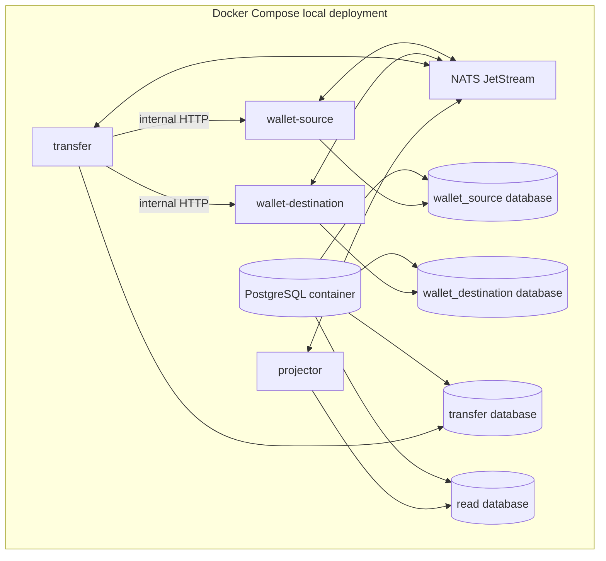

# Operations

This document is the operational contract for the Phase 2 local foundation. The Compose file and service startup validation are executable; business tables, CLIs, and service behavior are intentionally deferred to their implementation phases.

## Local deployment

The intended local deployment contains two isolated wallet databases, one transfer database, one read database, NATS JetStream, two wallet service instances, transfer service, projector, and optional migration/CLI containers.



`wallet-source` and `wallet-destination` use the same binary and separate database URLs/roles. The transfer role has no grants on either wallet database. The projector role has no write access to wallet or transfer source schemas.

## Run locally

Requirements: Go 1.23 or newer, Docker Engine/Desktop with the Compose v2 plugin, Node.js/npm for the documentation validator, and a shell with Bash.

```text
make up
make migrate
curl http://localhost:8081/healthz
curl http://localhost:8081/readyz
make role-isolation
make down
```

`make up` builds the three multi-stage service images and starts PostgreSQL, NATS JetStream, `wallet-source`, `wallet-destination`, `transfer`, and `projector`. Compose healthchecks wait for PostgreSQL/NATS before starting the services and each service healthcheck calls `/readyz`.

## Environment variables

Compose supplies the following local values. In another environment, set equivalent values without committing credentials.

| Variable | wallet instances | transfer | projector | Validation |
| --- | --- | --- | --- | --- |
| `SERVICE_NAME` | `wallet` | `transfer` | `projector` | Required logical service identity. |
| `INSTANCE_NAME` | `wallet-source` / `wallet-destination` | `transfer` | `projector` | Required logical instance identity. |
| `HTTP_ADDR` | `:8080` | `:8080` | `:8080` | Listener address. |
| `DATABASE_URL` | `postgres://.../wallet_source` or `wallet_destination` | `postgres://.../transfer` | `postgres://.../read` | PostgreSQL URL with a service-specific role. |
| `NATS_URL` | `nats://nats:4222` | `nats://nats:4222` | `nats://nats:4222` | NATS URL; required for readiness. |
| `LOG_LEVEL` | `info` | `info` | `info` | `debug`, `info`, `warn`, or `error`. |
| `HEALTH_TIMEOUT` | default `2s` | default `2s` | default `2s` | Positive readiness-check timeout. |
| `SHUTDOWN_TIMEOUT` | default `10s` | default `10s` | default `10s` | Positive graceful-shutdown timeout. |
| `WALLET_TEST_DATABASE_URL` | integration tests only | N/A | N/A | PostgreSQL URL used by the real wallet integration suite. |

The database passwords in `deploy/docker-compose.yml` and `deploy/postgres/init/001-roles-and-databases.sql` are local-only development credentials.

## Configuration contract

The exact names become `.env.example` in Phase 2. Required configuration groups are:

| Group | Examples | Rule |
| --- | --- | --- |
| Service identity | `SERVICE_NAME`, `INSTANCE_NAME`, `HTTP_ADDR` | Instance identity is explicit; no implicit source/destination behavior. |
| PostgreSQL | `DATABASE_URL`, `DB_MAX_OPEN`, `DB_MAX_IDLE` | Credentials are service-specific and never committed. |
| NATS | `NATS_URL`, `NATS_STREAM`, `NATS_CONSUMER` | JetStream is required for relay/consumer readiness, not wallet commit. |
| Retry/timeouts | step timeout, max attempts, backoff, gap timeout | Bounded and observable; timeout does not imply compensation. |
| Projection | active version, rebuild retention, promotion lock timeout | Rebuild must target inactive version. |
| Logging | `LOG_LEVEL`, `LOG_FORMAT` | Structured `slog`; no secrets or full payment payloads. |

## Migrations and startup

Phase 2 uses Goose through the `GOOSE_VERSION`-pinned `go run` command in the Makefile. Wallet source and destination both use `migrations/wallet`; transfer uses `migrations/transfer`; projector/read uses `migrations/projector`.

```text
make migrate-wallet-source
make migrate-wallet-destination
make migrate-transfer
make migrate-read
make migrate
```

Each directory currently contains only an empty baseline migration. Service startup validates connectivity but does not silently run migrations. A migration may add constraints or tables but must not rewrite immutable journal history. Rollbacks that could destroy evidence are not automatic.

## Planned CLIs

| Command | Purpose |
| --- | --- |
| `walletctl balance` | Journal-derived authoritative balance. |
| `walletctl entries` | Inspect immutable journal entries. |
| `transferctl inspect` | Show saga steps, attempts, operation IDs, and exceptions. |
| `transferctl reconcile` | Resolve/query an ambiguous operation; no silent adjustment. |
| `projectorctl rebuild` | Build inactive projection version, validate, and optionally promote. |
| `projectorctl rollback` | Atomically point to retained previous version. |
| `outboxctl inspect` | Inspect stale, failed, and repeatedly redelivered outbox rows. |

## Troubleshooting rules

- NATS down during a wallet command: the database transaction may commit; inspect outbox rather than retrying with a new idempotency key.
- Stale projected balance: compare `read_model_consistent_through` and use the authoritative wallet endpoint.
- Transfer capture timeout: inspect operation status and open/reuse reconciliation exception; do not compensate on timeout alone.
- Outbox backlog: inspect oldest row, relay errors, NATS health, and database locks; do not delete rows to reduce lag.
- Projection checksum failure: keep the active version, retain failed rebuild evidence, and investigate source events.
- Negative available balance or journal imbalance: stop affected writes, page, and run replay/reconciliation; never insert an adjustment row outside the domain command.
- `make role-isolation` fails: ensure the Compose PostgreSQL volume was initialized with the role script; a pre-existing volume does not rerun init scripts, so use `make down` followed by `docker compose -f deploy/docker-compose.yml down -v` only for disposable local data.
