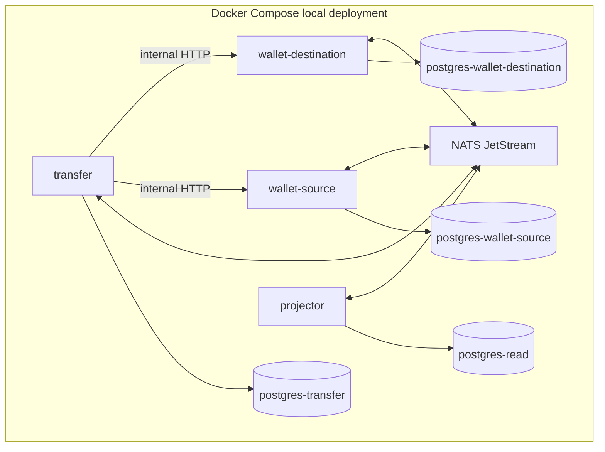

# Operations

This document is the operational contract. Executable Compose files, migrations, service CLIs, and environment validation are introduced in Phase 2 and must keep this interface current.

## Local deployment

The intended local deployment contains two isolated wallet databases, one transfer database, one read database, NATS JetStream, two wallet service instances, transfer service, projector, and optional migration/CLI containers.

`wallet-source` and `wallet-destination` use the same binary and separate database URLs/roles. The transfer role has no grants on either wallet database. The projector role has no write access to wallet or transfer source schemas.

## Configuration contract

The exact names become `.env.example` in Phase 2. Required configuration groups are:

| Group | Examples | Rule |
| --- | --- | --- |
| Service identity | `SERVICE_NAME`, `INSTANCE_NAME`, `HTTP_ADDR` | Instance identity is explicit; no implicit source/destination behavior. |
| PostgreSQL | `DATABASE_URL`, `DB_MAX_OPEN`, `DB_MAX_IDLE` | Credentials are service-specific and never committed. |
| NATS | `NATS_URL`, `NATS_STREAM`, `NATS_CONSUMER` | JetStream is required for relay/consumer readiness, not wallet commit. |
| Retry/timeouts | step timeout, max attempts, backoff, gap timeout | Bounded and observable; timeout does not imply compensation. |
| Projection | active version, rebuild retention, promotion lock timeout | Rebuild must target inactive version. |
| Logging | `LOG_LEVEL`, `LOG_FORMAT` | Structured `slog`; no secrets or full payment payloads. |

## Migrations and startup

Migrations run per database and per service role. Startup verifies schema version and fails closed when required migrations are missing. A migration may add constraints or tables but must not rewrite immutable journal history. Rollbacks that could destroy evidence are not automatic.

## Planned CLIs

| Command | Purpose |
| --- | --- |
| `walletctl balance` | Journal-derived authoritative balance. |
| `walletctl entries` | Inspect immutable journal entries. |
| `transferctl inspect` | Show saga steps, attempts, operation IDs, and exceptions. |
| `transferctl reconcile` | Resolve/query an ambiguous operation; no silent adjustment. |
| `projectorctl rebuild` | Build inactive projection version, validate, and optionally promote. |
| `projectorctl rollback` | Atomically point to retained previous version. |
| `outboxctl inspect` | Inspect stale, failed, and repeatedly redelivered outbox rows. |

## Troubleshooting rules

- NATS down during a wallet command: the database transaction may commit; inspect outbox rather than retrying with a new idempotency key.
- Stale projected balance: compare `read_model_consistent_through` and use the authoritative wallet endpoint.
- Transfer capture timeout: inspect operation status and open/reuse reconciliation exception; do not compensate on timeout alone.
- Outbox backlog: inspect oldest row, relay errors, NATS health, and database locks; do not delete rows to reduce lag.
- Projection checksum failure: keep the active version, retain failed rebuild evidence, and investigate source events.
- Negative available balance or journal imbalance: stop affected writes, page, and run replay/reconciliation; never insert an adjustment row outside the domain command.
