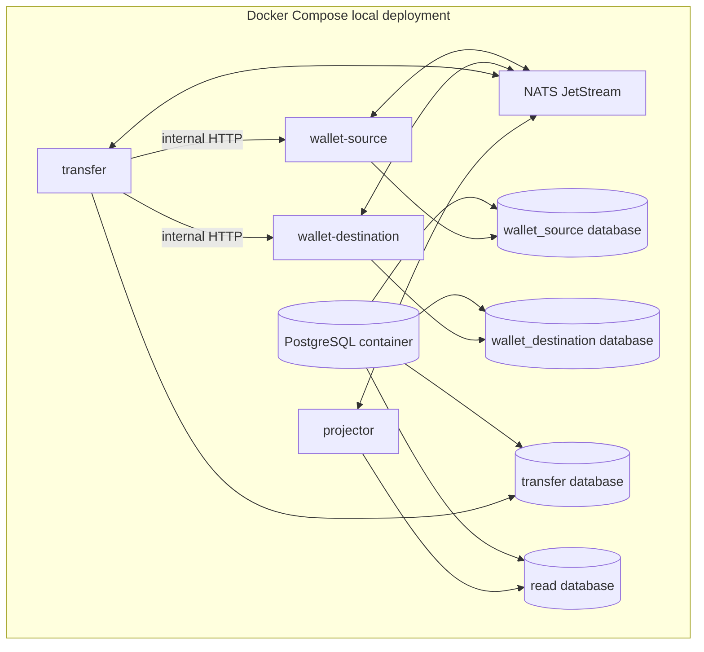

# Operations

This document is the operational contract for the completed v1 local stack. The Compose file, migration targets, role-isolation checks, wallet relay, dual-slot projector, transfer saga, reconciliation lifecycle, read APIs, operator CLIs, and benchmark harness are executable.

## Local deployment

The intended local deployment contains two isolated wallet databases, one transfer database, one read database, NATS JetStream, two wallet service instances, transfer service, projector, and optional migration/CLI containers.



`wallet-source` and `wallet-destination` use the same binary and separate database URLs/roles. The transfer role has no grants on either wallet database. The projector role has no write access to wallet or transfer source schemas. `migrator_role` owns the databases and migration-created objects; runtime roles are non-owners.

## Run locally

Requirements: Go 1.23 or newer, Docker Engine/Desktop with the Compose v2 plugin, Node.js/npm for the documentation validator, and a shell with Bash.

```text
make up
make migrate
make test-integration
curl http://localhost:8081/healthz
curl http://localhost:8081/readyz
make role-isolation
make down
```

`make up` builds the three multi-stage service images and starts PostgreSQL, NATS JetStream, `wallet-source`, `wallet-destination`, `transfer`, and `projector`. Compose healthchecks wait for PostgreSQL/NATS before starting the services and each service healthcheck calls `/readyz`. Wallet `/readyz` returns HTTP 503 when PostgreSQL is unavailable; a NATS failure is reported as `degraded` with HTTP 200 because wallet commits are database/outbox transactions.

## Environment variables

Compose supplies the following local values. In another environment, set equivalent values without committing credentials.

| Variable | wallet instances | transfer | projector | Validation |
| --- | --- | --- | --- | --- |
| `SERVICE_NAME` | `wallet` | `transfer` | `projector` | Required logical service identity. |
| `INSTANCE_NAME` | `wallet-source` / `wallet-destination` | `transfer` | `projector` | Required logical instance identity. |
| `HTTP_ADDR` | `:8080` | `:8080` | `:8080` | Listener address. |
| `INTERNAL_HTTP_ADDR` | `:8085` | `:8085` | `:8085` | Isolated internal listener. |
| `INTERNAL_TOKEN` | local shared token | local shared token | local shared token | Required on internal listener requests. |
| `DATABASE_URL` | `postgres://.../wallet_source` or `wallet_destination` | `postgres://.../transfer` | `postgres://.../read` | PostgreSQL URL with a service-specific role. |
| `NATS_URL` | `nats://nats:4222` | `nats://nats:4222` | `nats://nats:4222` | NATS URL; required for readiness. |
| `LOG_LEVEL` | `info` | `info` | `info` | `debug`, `info`, `warn`, or `error`. |
| `HEALTH_TIMEOUT` | default `2s` | default `2s` | default `2s` | Positive readiness-check timeout. |
| `SHUTDOWN_TIMEOUT` | default `10s` | default `10s` | default `10s` | Positive graceful-shutdown timeout. |
| `WALLET_TEST_DATABASE_URL` | integration tests only | N/A | N/A | PostgreSQL URL used by the real wallet integration suite. |
| `OUTBOX_RELAY_BATCH_SIZE` | default `50` | N/A | N/A | Maximum rows claimed per relay batch. |
| `OUTBOX_RELAY_POLL_INTERVAL` | default `250ms` | N/A | N/A | Delay between empty relay polls. |
| `OUTBOX_RELAY_LEASE` | default `5s` | N/A | N/A | Claim lease; longer than the bounded publish timeout. |
| `OUTBOX_PUBLISH_TIMEOUT` | default `2s` | N/A | N/A | Maximum NATS publish/PubAck wait. |
| `NATS_STREAM` | `WALLET_EVENTS` | `WALLET_EVENTS` | `WALLET_EVENTS` | File-backed event stream name. |
| `NATS_CONSUMER` | N/A | N/A | `projector` | Durable projector pull consumer name. |
| `ORDERING_GAP_WINDOW` | N/A | N/A | default `30s` | Missing predecessor window before an ordering gap row/alert. |
| `NATS_SUBJECT_PREFIX` | default `events` | default `events` | default `events` | Event subject namespace; integration suites use an isolated prefix. |
| `WALLET_VERIFY_URLS` | N/A | N/A | Compose wallet internal URLs | Comma-separated wallet verification endpoints used by promotion verification. |
| `WALLET_VERIFY_TOKEN` | N/A | N/A | shared local internal token | Token for cross-tenant verification calls. |
| `PROJECTION_VERIFICATION_TIMEOUT` | N/A | N/A | default `30s` | Full verification retry budget before promotion fails. |

The database passwords in `deploy/docker-compose.yml` and `deploy/postgres/init/001-roles-and-databases.sql` are local-only development credentials.

## Configuration contract

The exact names become `.env.example` in Phase 2. Required configuration groups are:

| Group | Examples | Rule |
| --- | --- | --- |
| Service identity | `SERVICE_NAME`, `INSTANCE_NAME`, `HTTP_ADDR` | Instance identity is explicit; no implicit source/destination behavior. |
| PostgreSQL | `DATABASE_URL`, `DB_MAX_OPEN`, `DB_MAX_IDLE` | Credentials are service-specific and never committed. |
| NATS | `NATS_URL`, `NATS_STREAM`, `NATS_CONSUMER` | JetStream is required for relay/consumer readiness, not wallet commit. |
| Retry/timeouts | step timeout, max attempts, backoff, gap timeout | Bounded and observable; timeout does not imply compensation. |
| Projection | active version, rebuild retention, promotion lock timeout | Rebuild must target inactive version. |
| Logging | `LOG_LEVEL`, `LOG_FORMAT` | Structured `slog`; no secrets or full payment payloads. |

## Migrations and startup

Goose uses the `GOOSE_VERSION`-pinned `go run` command in the Makefile. Wallet source and destination both use `migrations/wallet`; transfer uses `migrations/transfer`; projector/read uses `migrations/projector`. Every migration target uses a database-specific URL for `migrator_role`; the service URLs above are for application traffic and tests.

```text
make migrate-wallet-source
make migrate-wallet-destination
make migrate-transfer
make migrate-read
make migrate
```

The wallet directory contains the ledger and owner-separation migrations; projector/read now also contains the dual-slot projection tables and rebuild metadata. Service startup validates connectivity but does not silently run migrations. A migration may add constraints or tables but must not rewrite immutable journal history. Rollbacks that could destroy evidence are not automatic.

For a fresh local volume, the init script creates `migrator_role` and makes it the owner of all four databases. For an existing deployment, a PostgreSQL administrator must transfer database/schema/object ownership to the migrator before applying the owner-separation migration; the migration cannot take ownership of objects owned by an unrelated role. Local validation can reset disposable state with `docker compose -f deploy/docker-compose.yml down -v` before `make up`.

The wallet service has `SELECT`/`INSERT` access to wallet tables and no UPDATE on accounts, wallets, immutable journal/event tables, or idempotency records. Wallet writes serialize with a transaction-scoped advisory lock; same-key idempotency requests insert one completed response.

## Phase 4 delivery and stats

The wallet process relays its own committed outbox rows. It claims with `FOR UPDATE SKIP LOCKED` and a short `locked_until` lease, publishes outside the claim transaction, and marks `published_at` only after a JetStream PubAck. The projector bootstraps the `WALLET_EVENTS` stream and its durable explicit-ACK pull consumer idempotently at startup.

The stream contract is:

| Setting | Value | Reason |
| --- | --- | --- |
| Subjects | `events.>` | Tenant/aggregate/event routing without global FIFO assumptions. |
| Storage | File | Durable local delivery for Compose and replay. |
| Duplicate window | `2m` | Covers relay lease expiry/retry duplicates. |
| Consumer | durable `projector`, pull, explicit ACK | Backpressure and ACK-after-DB-commit. |
| `AckWait` | `30s` | Exceeds normal DB transaction time while allowing redelivery. |
| `MaxDeliver` | `5` | Poison-event bound before dead-letter recording. |
| `MaxAckPending` | `100` | Bounded projector in-flight work. |

The internal stats endpoint is `GET /internal/v1/stats` on wallet, transfer, and projector services. Wallet/projector stats report outbox or projection health; transfer stats report saga step totals and retry counts.

All `/internal/*` routes are isolated on a dedicated secondary HTTP listener (`INTERNAL_HTTP_ADDR`, default `:8085`), separate from the public traffic listener (`HTTP_ADDR`, default `:8080`). The public listener returns `404 Not Found` for any `/internal/*` request. Access to the internal listener requires an `X-Internal-Token` header, validated using constant-time comparison (`crypto/subtle.ConstantTimeCompare`) against the configured `INTERNAL_TOKEN`; invalid or omitted tokens return `401 Unauthorized`. In Docker Compose, internal ports are published strictly on loopback interfaces (`127.0.0.1:8181:8085` for wallet-source, `127.0.0.1:8182:8085` for wallet-destination, `127.0.0.1:8183:8085` for transfer, and `127.0.0.1:8184:8085` for projector). The current observability surface is the internal stats APIs and benchmark artifacts; a production metrics backend remains future scope.

## Operator CLIs

| Command | Purpose |
| --- | --- |
| `make walletctl` / `bin/walletctl balance` | Journal-derived balance and active holds. |
| `bin/walletctl entries` | Inspect immutable journal entries. |
| `bin/walletctl replay` | Verify journal transaction balancing without adjusting rows. |
| `make transferctl` / `bin/transferctl inspect` | Show saga steps, attempts, operation IDs, and state. |
| `bin/transferctl exceptions` | List tenant-scoped reconciliation exceptions. |
| `bin/transferctl reconcile` | Claim and explicitly resolve an exception through the internal listener. |
| `make projectorctl` | Build the local projectorctl binary (ignored under `bin/`). |
| `projectorctl rebuild [--auto-promote]` | Clear the inactive slot, replay durable event envelopes, verify, and optionally promote. |
| `projectorctl status` | Show the latest rebuild state. |
| `projectorctl promote --rebuild-id <uuid>` | Atomically point reads at a READY candidate. |
| `projectorctl rollback` | Atomically point to the retained previous slot. |
| `projectorctl retire` | Clear the inactive retained slot after the rollback window. |
| `make dev-wipe-active-slot` | Disposable-dev-only wipe using `migrator_role`; never use in an acceptance run. |
| `make outboxctl` / `bin/outboxctl inspect` | Inspect stale, failed, and repeatedly redelivered outbox rows. |

`transferctl reconcile` requires `--url`, `--token`, `--tenant`,
`--exception`, and `--operator-id`. It never creates a journal adjustment;
resolution evidence is recorded against the immutable exception lifecycle.

## Phase 8 benchmark harness

The standalone `benchmarks` module exercises the running services through their
public and internal HTTP contracts:

```text
make benchmark ARGS="-ops=50 -concurrency=16 -repeats=3"
```

Use `-workloads=` to select a subset. The six workload names and generated
results are documented in [`benchmarking.md`](benchmarking.md). Run the local
stack and migrations before starting a benchmark; benchmark output is diagnostic
evidence and must not be treated as a production SLO.

## Troubleshooting rules

- NATS down during a wallet command: the database transaction may commit; inspect outbox rather than retrying with a new idempotency key.
- Stale projected balance: compare `read_model_consistent_through` and use the authoritative wallet endpoint.
- Transfer capture timeout: inspect operation status and open/reuse reconciliation exception; do not compensate on timeout alone.
- Outbox backlog: inspect oldest row, relay errors, NATS health, and database locks; do not delete rows to reduce lag.
- Projection checksum failure: keep the active version, retain failed rebuild evidence, and investigate source events.
- Projection rebuild: run `make projectorctl`, then `DATABASE_URL=... bin/projectorctl rebuild`; inspect `status`, promote only a `READY` result, and use `rollback` if the active slot needs to be restored. The verifier compares wallet internal snapshots at equal versions and never repairs mismatches.
- Negative available balance or journal imbalance: stop affected writes, page, and run replay/reconciliation; never insert an adjustment row outside the domain command.
- `make role-isolation` fails: ensure the Compose PostgreSQL volume was initialized with the role script; a pre-existing volume does not rerun init scripts, so use `make down` followed by `docker compose -f deploy/docker-compose.yml down -v` only for disposable local data.
