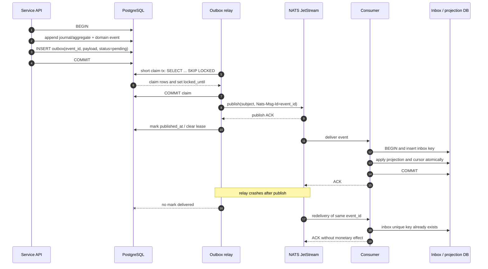
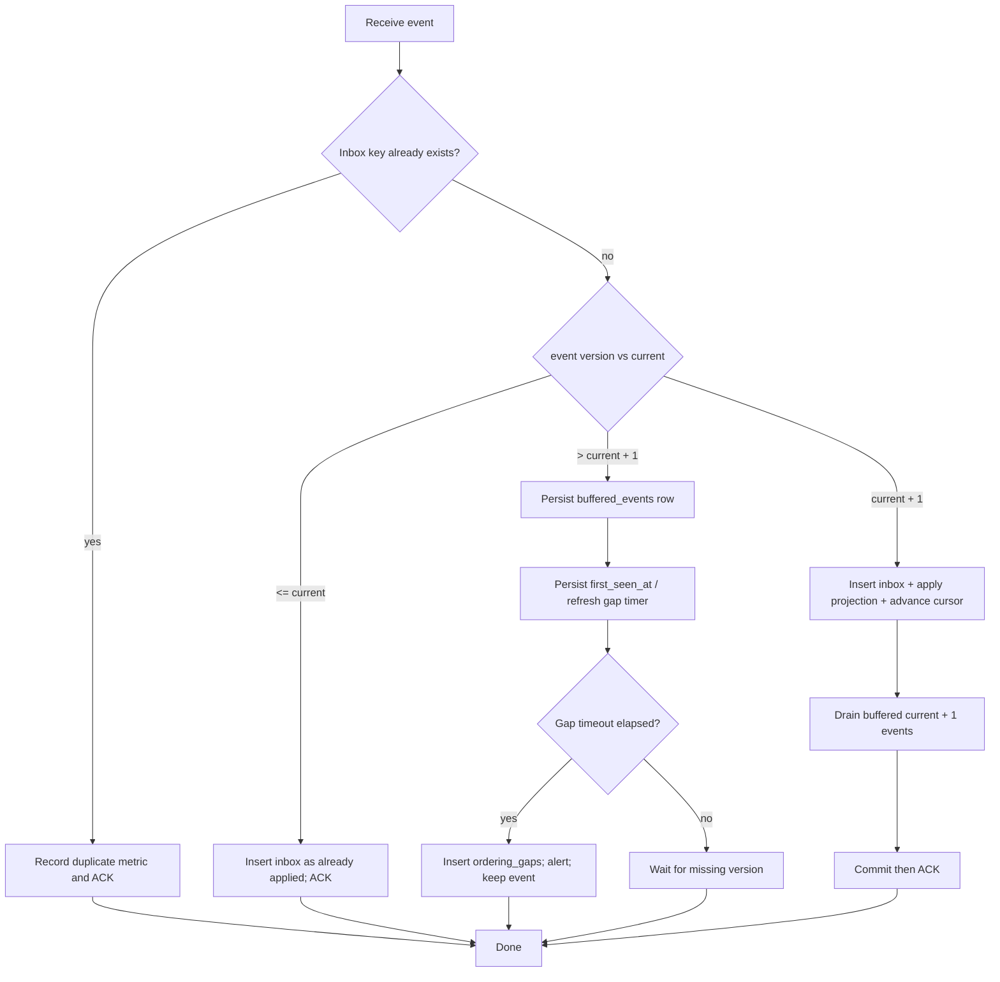

# Outbox and inbox

## Transactional outbox flow

The wallet or transfer write transaction stores business state, the domain event, and the outbox row in one PostgreSQL transaction. The relay publishes committed outbox rows to NATS JetStream using `Nats-Msg-Id: event_id`.

There is no global FIFO guarantee. Multiple relays may claim rows concurrently. The event's aggregate ID and version, the inbox, and consumer ordering logic provide correctness.

## Relay algorithm

1. Start a short claim transaction.
2. Select `published_at IS NULL` and `next_attempt_at <= now()` rows where `locked_until IS NULL OR locked_until < now()`, with `FOR UPDATE SKIP LOCKED`, ordered by `created_at, id`.
3. Set `locked_until = now() + relay lease` and commit. No row lock crosses a network call.
4. Publish with `Nats-Msg-Id = event_id` and wait for the JetStream PubAck.
5. On PubAck, set `published_at` and clear `locked_until`. On failure, increment `attempts`, store `last_error`, clear the lease, and schedule exponential backoff with bounded jitter.
6. Do not delete the row; retain delivery metadata for inspection and replay.

The lease is an operational coordination field, not the correctness mechanism. If a process dies after publish and before marking delivered, the lease expires and the event is republished with the same `Nats-Msg-Id`; JetStream duplicate suppression and the consumer inbox make this safe. A publish timeout is not treated as proof that the message was absent.

The relay uses a bounded publish timeout shorter than the lease. Two relays can claim different rows concurrently; `SKIP LOCKED` prevents the same non-expired lease from being claimed twice.

## Consumer algorithm and gap detection

The inbox key is `(tenant_id, consumer_name, event_id)`. Aggregate ordering state is keyed by `(tenant_id, consumer_name, aggregate_id)`. A consumer never advances a cursor over an unresolved gap. After `MaxDeliver`, the consumer stores the poison event and error in `dead_letter_events` before acknowledging it.

## Crash scenarios

| Crash point | Durable result | Safe recovery |
| --- | --- | --- |
| Before business commit | No aggregate, event, or outbox row | Client retries the idempotent command. |
| After commit, before relay | Pending outbox row | Relay claims and publishes later. |
| After NATS publish, before outbox mark | Event may be published twice | JetStream message ID and inbox dedup make duplicate harmless. |
| Consumer before inbox commit | No consumer effect | NATS redelivers. |
| Consumer after projection commit, before ACK | Inbox/cursor already committed | Redelivery sees inbox key and ACKs without reapplying. |
| Future event before missing event | Buffer row | Missing version replay or gap alert; no out-of-order projection. |
