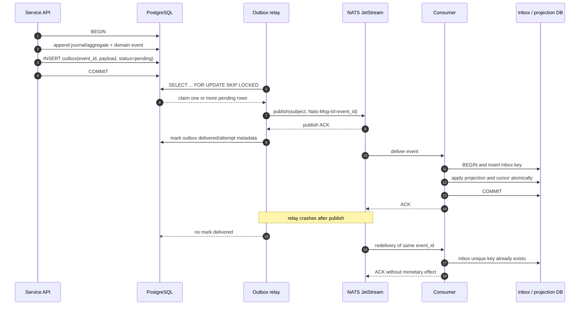
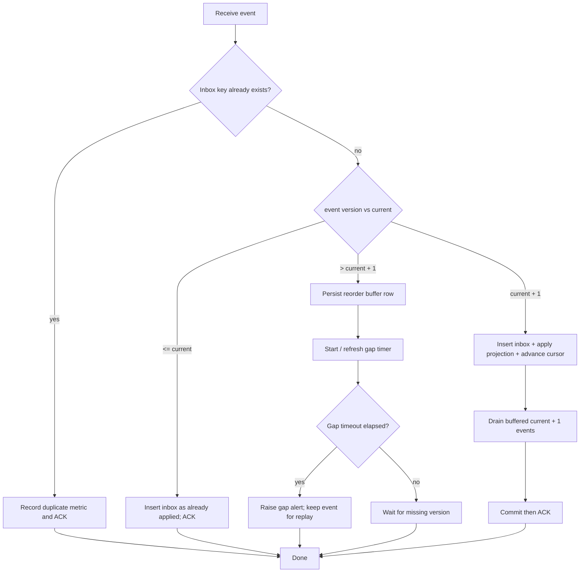

# Outbox and inbox

## Transactional outbox flow

The wallet or transfer write transaction stores business state, the domain event, and the outbox row in one PostgreSQL transaction. The relay publishes committed outbox rows to NATS JetStream using `Nats-Msg-Id: event_id`.

There is no global FIFO guarantee. Multiple relays may claim rows concurrently. The event's aggregate ID and version, the inbox, and consumer ordering logic provide correctness.

## Relay algorithm

1. Start a short transaction.
2. Select pending or retryable rows with `FOR UPDATE SKIP LOCKED`, ordered by `available_at, created_at`, and mark an attempt/lease.
3. Commit the claim so another relay does not publish the same lease concurrently.
4. Publish with `Nats-Msg-Id = event_id`.
5. On publish ACK, mark delivered. On failure, clear or expire the lease and schedule bounded backoff.
6. Do not delete the row immediately; retain delivery metadata for inspection and replay policy.

The lease is an operational coordination field, not the correctness mechanism. If a process dies after publish and before marking delivered, the duplicate publish is safe because the message ID and inbox key are stable.

## Consumer algorithm and gap detection

The inbox key is `(tenant_id, consumer_name, event_id)`. Aggregate ordering state is keyed by `(tenant_id, consumer_name, aggregate_id)`. A consumer never advances a cursor over an unresolved gap.

## Crash scenarios

| Crash point | Durable result | Safe recovery |
| --- | --- | --- |
| Before business commit | No aggregate, event, or outbox row | Client retries the idempotent command. |
| After commit, before relay | Pending outbox row | Relay claims and publishes later. |
| After NATS publish, before outbox mark | Event may be published twice | JetStream message ID and inbox dedup make duplicate harmless. |
| Consumer before inbox commit | No consumer effect | NATS redelivers. |
| Consumer after projection commit, before ACK | Inbox/cursor already committed | Redelivery sees inbox key and ACKs without reapplying. |
| Future event before missing event | Buffer row | Missing version replay or gap alert; no out-of-order projection. |
