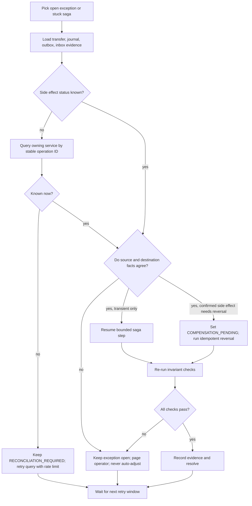

# Reconciliation

Reconciliation detects mismatches; it never auto-adjusts a balance. Every exception has evidence, an owner, a status, and an explicit resolution action.

## Checks

| Check | Frequency | Evidence | Action on mismatch |
| --- | --- | --- | --- |
| Journal entry balancing | On write and periodic replay | Debit and credit totals per transaction | Block the write or page immediately if found in stored data. |
| Journal replay vs authoritative balance | Scheduled and on demand | Recomputed wallet balances and checksum | Open `JOURNAL_REPLAY_MISMATCH`; no adjustment. |
| Source capture vs destination finalize | Per transfer and scheduled sweep | Transfer ID, amount, operation IDs, journal IDs | Hold transfer in exception; inspect both wallets. |
| Outbox completeness | Scheduled | Committed events without outbox rows; stale pending rows | Page and replay/fix through an operator command. |
| Inbox/projection completeness | Scheduled | Missing, duplicate, or stuck versions | Re-drive consumer or rebuild projection. |
| Saga liveness | Every minute | Step age, retry count, timeout state | Retry safe transient work or open an exception. |
| Projection checksum and row count | At rebuild and daily | Versioned view checksums | Do not promote; retain active version. |

## Exception lifecycle

```text
OPEN -> INVESTIGATING -> RESOLVED
                         \-> ACCEPTED_WITH_EVIDENCE (only for non-monetary operational discrepancy)

Opening evidence is immutable. Investigation evidence is appended as immutable
notes. Terminal exceptions are never reopened in place; a later contradiction
opens a new exception with new opening evidence.
```

Monetary exceptions cannot be marked resolved until the source and destination journal entries, idempotency keys, and transfer state agree. A resolution records who/what/when and links to immutable evidence.

## Worker decision tree



## Edge case: unacknowledged message drop on MaxDeliver crash

When a consumer worker crashes while processing its final allowed delivery attempt (`attempts == MaxDeliver`), JetStream considers delivery attempts exhausted and ceases redelivering the message without an application-level acknowledgment. If the worker process terminates before writing to `dead_letter_events` or `applied_events_log`, the message drops silently from JetStream stream delivery without a consumer dead-letter record.

The scheduled inbox and projection reconciliation sweep detects this scenario:

1. **Detection:** The reconciliation job compares the authoritative wallet aggregate sequence (`MAX(sequence_number) WHERE tenant_id = $1 AND aggregate_id = $2` from the wallet database `events` table) against the projector's `aggregate_cursors.last_applied_sequence` and `applied_events_log`.
2. **Identification:** If `latest_wallet_sequence > projector_cursor` and no pending row in `buffered_events` or active timer in `ordering_gaps` is resolving within the gap window, the reconciliation job flags an `ORPHANED_STREAM_EVENT` exception.
3. **Remediation:** The reconciliation job or operator runbook queries the source `events` row by `(tenant_id, aggregate_id, sequence_number)` and re-enqueues or directly republishes the immutable event to the JetStream subject with its original event ID and sequence number. The consumer's inbox deduplication and aggregate advisory locking ensure idempotent processing without double application.

## Operator runbook

1. Identify the exception and freeze automatic retries for that transfer if needed.
2. Inspect transfer state, step attempts, operation IDs, and correlation IDs.
3. Inspect both wallet journals by tenant and wallet; compare journal IDs and amounts, not only read-model balances.
4. Inspect outbox delivery and consumer inbox/cursor state.
5. If an outcome is ambiguous, query the owning wallet service by operation ID. Do not issue a new money-moving command until status is known.
6. Resume a safe step, run an idempotent reversal, or escalate for manual approval according to the decision tree.
7. Run journal replay and transfer conservation checks.
8. Record evidence and close only after invariants pass. Never insert an offsetting “fix” without a domain reversal command and audit trail.
