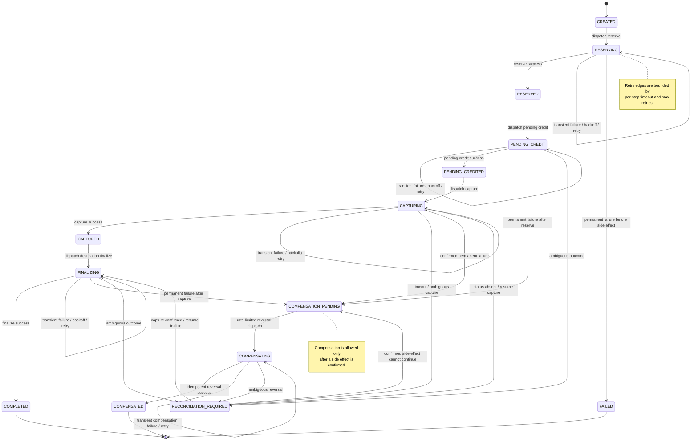
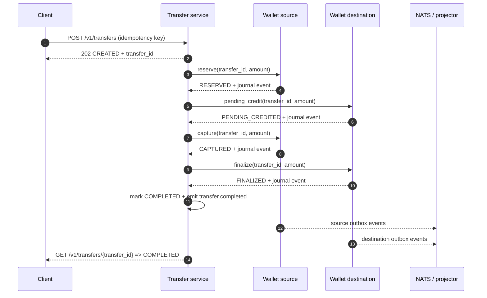
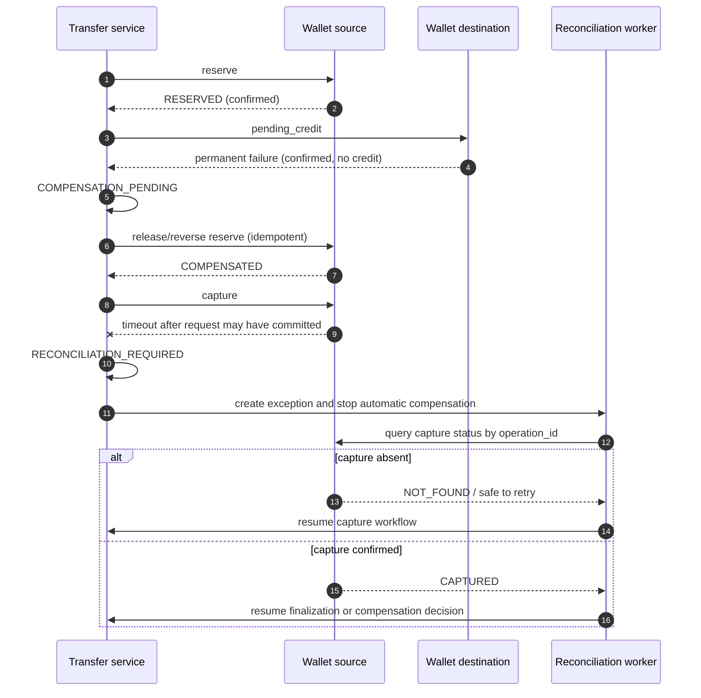

# Transfer saga

The transfer service coordinates a wallet-to-wallet transfer across two independent wallet databases. It owns the transfer state machine, step attempts, timeout classification, and operator-visible outcome. It never writes wallet tables directly.

## State machine

Retry edges are intentionally distinct from compensation and reconciliation edges. A slow dependency is not evidence that money moved or did not move.

## Step contract

| Step | Request owner | Side effect | Success evidence | Retry policy | Failure after side effect |
| --- | --- | --- | --- | --- | --- |
| Create | transfer | Transfer row and saga created | Idempotent transfer response | N/A | Return original result |
| Reserve | source wallet | Journal-backed source hold | Wallet command response plus event | Exponential backoff, bounded attempts | Reversal only if confirmed |
| Pending credit | destination wallet | Journal-backed pending destination credit | Wallet command response plus event | Exponential backoff, bounded attempts | Compensate confirmed reserve |
| Capture | source wallet | Held amount committed to outbound settlement | Capture response plus event | Retry only when outcome is known transient | Timeout is reconciliation, not compensation |
| Finalize | destination wallet | Pending credit becomes spendable | Finalize response plus event | Exponential backoff, bounded attempts | Compensation of confirmed source capture and destination state as needed |
| Compensate | affected wallet(s) | Idempotent reversal journal entry | Reversal response plus event | Rate-limited, bounded worker retries | Reconciliation exception |

Every step carries a stable operation ID derived from transfer ID and step name. Wallet endpoints treat that operation ID as an idempotency key. A retried request must return the original result, not append a second entry.

## Failure classification

| Classification | Examples | Action |
| --- | --- | --- |
| Transient | HTTP 503, connection reset before response, known retryable database serialization failure | Retry with per-step timeout, exponential backoff, jitter, and max attempts. Do not compensate only because it is slow. |
| Permanent, confirmed side effect | Destination rejects a known-valid request after source reserve/capture is confirmed | Set `COMPENSATION_PENDING`, perform an idempotent reversal, then `COMPENSATED`; rate-limit compensation. |
| Ambiguous | Capture timeout, connection lost after request could have committed, wallet restart during response | Set `RECONCILIATION_REQUIRED`, write `reconciliation_exceptions`, and stop automatic money movement until status is known. |

## Happy path

## Failure paths

## Terminal rules

- `COMPLETED` requires source capture and destination finalization for the same transfer, amount, currency, and tenant.
- `COMPENSATED` requires every confirmed monetary side effect to have a matching idempotent reversal.
- `FAILED` is allowed only before any confirmed monetary side effect.
- `RECONCILIATION_REQUIRED` is not a failure that can be silently retried. It is a durable operator/work-queue state.
